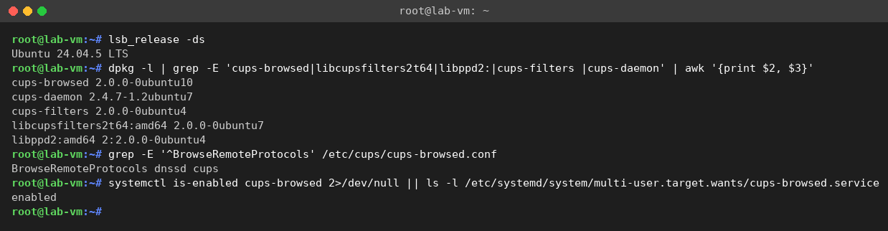
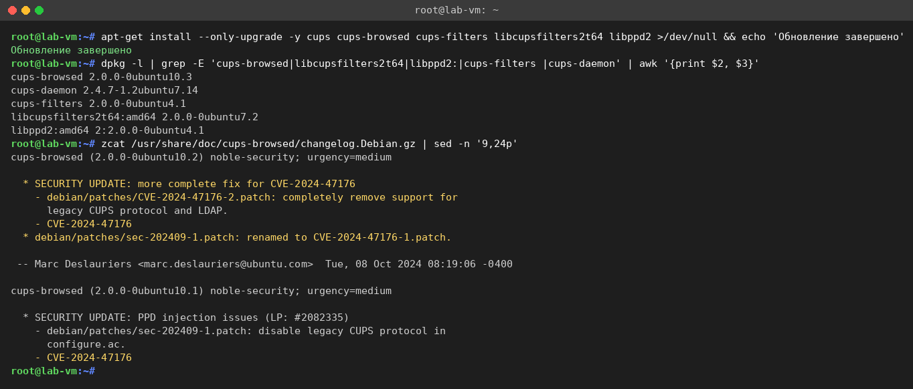
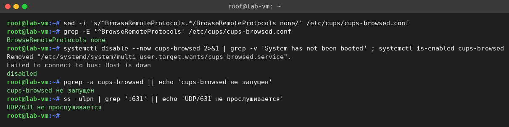
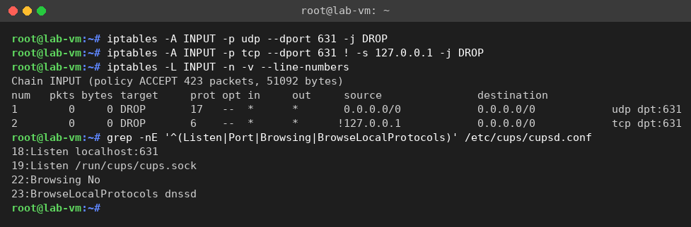
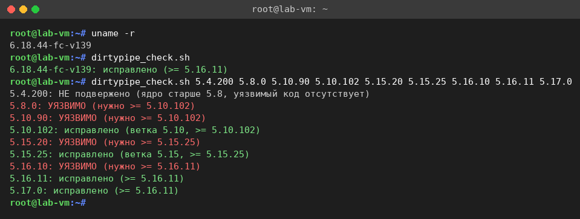
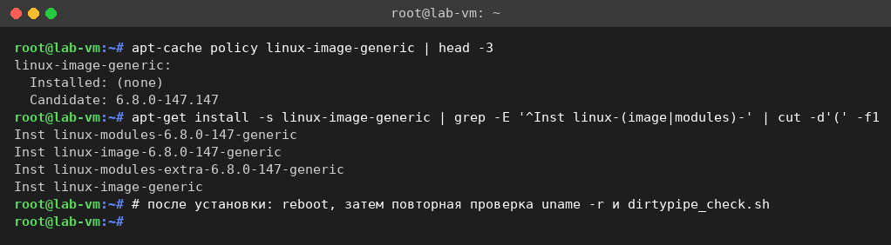

# 🛡️ Анализ уязвимостей CUPS и Dirty Pipe

Учебный проект по дисциплине **«Защита операционных систем»**: отчёт по двум резонансным группам уязвимостей Linux — цепочке в системе печати **CUPS** и уязвимости ядра **Dirty Pipe** — вместе с готовыми изолированными стендами и скриптами обнаружения/устранения.


> ⚠️ **Только для обучения в изолированной среде.** Стенды намеренно содержат устаревшие (уязвимые) компоненты, поэтому их нельзя подключать к рабочим сетям или публиковать порты наружу. Рабочий эксплойт-код в проект **не включён** — предоставлены только средства обнаружения уязвимого состояния и его устранения.

---

# ОТЧЁТ

**Тема:** Анализ уязвимостей системы печати CUPS (CVE-2024-47076, 47175, 47176, 47177) и уязвимости ядра Linux «Dirty Pipe» (CVE-2022-0847). Механизмы, последствия и методы устранения.

## Содержание

1. [Введение](#1-введение)
2. [Уязвимости системы печати CUPS](#2-уязвимости-системы-печати-cups)
3. [Уязвимость ядра Linux «Dirty Pipe» (CVE-2022-0847)](#3-уязвимость-ядра-linux-dirty-pipe-cve-2022-0847)
4. [Сводная таблица](#4-сводная-таблица)
5. [Приложение. Исходный код скриптов](#приложение-исходный-код-скриптов)

---

## 1. Введение

Данный отчёт посвящён двум резонансным группам уязвимостей в экосистеме Linux, представляющим прямую угрозу безопасности операционной системы:

- цепочка уязвимостей в системе печати **CUPS** (компоненты `cups-browsed`, `libcupsfilters`, `libppd`, `cups-filters`), раскрытая в сентябре 2024 года и позволяющая удалённое выполнение кода;
- уязвимость ядра Linux **«Dirty Pipe»** (CVE-2022-0847), позволяющая локальному пользователю повысить привилегии до root.

Для каждой уязвимости приводится: описание, затронутые версии, механизм работы, последствия и оценка критичности по шкале CVSS, способы обнаружения уязвимого состояния и методы устранения. Шаги проверки и закрытия уязвимостей сопровождаются скриншотами.

---

## 2. Уязвимости системы печати CUPS

### 2.1. Общее описание цепочки

CUPS (Common UNIX Printing System) — стандартная система печати в большинстве дистрибутивов Linux и других UNIX-подобных ОС. Отдельный фоновый сервис `cups-browsed` отвечает за автоматическое обнаружение сетевых принтеров. 26 сентября 2024 года исследователь Simone Margaritelli раскрыл цепочку из четырёх уязвимостей, совместная эксплуатация которых приводит к удалённому выполнению произвольного кода (RCE) на системе-жертве.

Ключевая проблема в том, что сервис `cups-browsed` по умолчанию принимает пакеты на UDP-порту 631 от любого источника в сети (и даже из Интернета, если порт доступен). Злоумышленник отправляет один UDP-пакет, который заставляет `cups-browsed` обратиться к подконтрольному атакующему «принтеру», получить от него вредоносный PPD-файл и зарегистрировать фальшивый принтер в системе. Когда пользователь отправляет что-либо на печать на этот принтер, срабатывает внедрённая команда.

### 2.2. Разбор отдельных CVE

| CVE | Компонент | Суть уязвимости |
|---|---|---|
| **CVE-2024-47176** | `cups-browsed` | Сервис слушает UDP/631 и доверяет пакетам от любого источника. Поддельный пакет инициирует запрос `Get-Printer-Attributes` к URL, заданному атакующим. |
| **CVE-2024-47076** | `libcupsfilters` | Данные (IPP-атрибуты), полученные от удалённого «принтера», не проверяются и не фильтруются перед дальнейшей обработкой. |
| **CVE-2024-47175** | `libppd` | Непроверенные IPP-данные записываются во временный PPD-файл, что позволяет внедрить произвольные директивы в PPD. |
| **CVE-2024-47177** | `cups-filters` | Внедрение команд через параметр PPD `FoomaticRIPCommandLine` — позволяет выполнить произвольную команду при обработке задания печати. |

Сами по себе уязвимости имеют ограниченное применение, но в цепочке образуют полноценный вектор удалённого выполнения кода: 47176 даёт точку входа, 47076 и 47175 позволяют доставить вредоносный PPD, а 47177 — выполнить команду.

### 2.3. Затронутые версии

- `cups-browsed` — версии ≤ 2.0.1;
- `libcupsfilters` — версии ≤ 2.1b1;
- `libppd` — версии ≤ 2.1b1;
- `cups-filters` — версии ≤ 2.0.1.

Уязвимы практически все дистрибутивы с установленным и запущенным `cups-browsed`: многие сборки Linux (Debian/Ubuntu, RHEL/Fedora, openSUSE, Arch и др.), а также ряд BSD-систем. Критическим фактором является именно запущенный сервис `cups-browsed` и доступность UDP-порта 631.

### 2.4. Механизм эксплуатации

Последовательность атаки:

1. Атакующий отправляет поддельный UDP-пакет на порт 631 жертвы (**CVE-2024-47176**).
2. `cups-browsed` воспринимает это как анонс нового сетевого принтера и обращается к указанному в пакете адресу за описанием принтера.
3. Подконтрольный атакующему сервер возвращает вредоносные IPP-атрибуты, которые без проверки попадают в сгенерированный PPD-файл (**CVE-2024-47076**, **CVE-2024-47175**).
4. В PPD внедряется директива `FoomaticRIPCommandLine` с произвольной командой (**CVE-2024-47177**).
5. Команда выполняется в момент печати на этот фальшивый принтер — то есть требуется действие пользователя (отправка задания на печать).

> **Ограничение реальной эксплуатации:** для выполнения кода необходимо, чтобы жертва отправила задание печати на подставной принтер. Это снижает «практическую» критичность по сравнению с первыми оценками, но не отменяет необходимости устранения.

### 2.5. Последствия и оценка CVSS

Успешная эксплуатация приводит к выполнению произвольного кода. Важная деталь: процессы фильтров печати в современных конфигурациях выполняются от непривилегированного пользователя `lp` (а не root), поэтому прямого получения root обычно не происходит — но закрепления в системе и дальнейшего развития атаки (в т.ч. в связке с локальной уязвимостью вроде Dirty Pipe) достаточно.

| CVE | CVSS v3.1 | Уровень |
|---|---|---|
| CVE-2024-47076 | 8.6 | Высокий |
| CVE-2024-47175 | 8.6 | Высокий |
| CVE-2024-47176 | 8.4 | Высокий |
| CVE-2024-47177 | 9.1 | Критический |

На момент раскрытия (сентябрь 2024) в Интернете насчитывалось порядка **75 000** доступных хостов с открытой службой CUPS, что подчёркивает масштаб потенциальной поверхности атаки.

### 2.6. Обнаружение уязвимого состояния

Признаки уязвимой системы: установлен и запущен `cups-browsed` устаревшей версии; сервис слушает UDP-порт 631; в конфигурации включён приём удалённых протоколов (`BrowseRemoteProtocols`).



*Рис. 1. Исходное (уязвимое) состояние: установлены старые версии пакетов (cups-browsed 2.0.0-0ubuntu10, cups-filters 2.0.0-0ubuntu4), включён `BrowseRemoteProtocols`, сервис cups-browsed активен.*

Дополнительно можно проверить прослушиваемые порты командой `ss -ulpn | grep 631` — наличие cups-browsed на `0.0.0.0:631` указывает на приём пакетов из сети от любого источника.

### 2.7. Устранение уязвимостей

Применяется комплекс мер: обновление пакетов до исправленных версий, отключение/удаление лишнего сервиса `cups-browsed` и ограничение доступа к порту 631 межсетевым экраном.

**Шаг 1. Обновление пакетов до исправленных версий.**



*Рис. 2. Обновление пакетов. Версии после установки обновлений: cups-browsed 2.0.0-0ubuntu10.3, cups-filters 2.0.0-0ubuntu4.1, libcupsfilters 2.0.0-0ubuntu7.2, libppd 2.0.0-0ubuntu4.1. В changelog видно применение патчей для CVE-2024-47176.*

**Шаг 2. Отключение приёма удалённых протоколов и остановка/отключение сервиса `cups-browsed`.** Если сетевое автообнаружение принтеров не требуется, сервис рекомендуется полностью отключить (или удалить).



*Рис. 3. `BrowseRemoteProtocols` переведён в `none`, сервис cups-browsed отключён (disabled) и остановлен, UDP-порт 631 более не прослушивается.*

**Шаг 3. Ограничение доступа к порту 631 межсетевым экраном** (запрет внешних подключений, особенно по UDP).



*Рис. 4. Правила iptables: входящий трафик на UDP/631 отбрасывается, TCP/631 разрешён только с локального адреса (127.0.0.1).*

> В промышленной среде удобнее использовать штатный межсетевой экран дистрибутива (`ufw`/`firewalld`) и сохранять правила между перезагрузками.

---

## 3. Уязвимость ядра Linux «Dirty Pipe» (CVE-2022-0847)

### 3.1. Описание

Dirty Pipe — уязвимость в подсистеме каналов (pipe) ядра Linux, обнаруженная Максом Келлерманом (Max Kellermann) и опубликованная в марте 2022 года. Она позволяет непривилегированному локальному пользователю перезаписывать данные в произвольных файлах, доступных ему только на чтение, в том числе в системных файлах. Это открывает прямой путь к локальному повышению привилегий до root.

### 3.2. Затронутые версии

- Уязвимость появилась в ядре Linux версии **5.8**.
- Уязвимы ядра от 5.8 до версий, в которых внесено исправление.
- Исправлено в ядрах **5.16.11**, **5.15.25** и **5.10.102** (и более поздних в соответствующих ветках).

Таким образом, безопасными считаются ядра: в ветке 5.10 — не ниже 5.10.102; в ветке 5.15 — не ниже 5.15.25; в ветке 5.16 — не ниже 5.16.11; а также все ядра 5.17+ и новее. Ядра старше 5.8 уязвимому коду не подвержены.

### 3.3. Механизм

Уязвимость связана с неинициализированным флагом в структуре, описывающей страницу данных канала (`pipe_buffer`). При определённой последовательности операций со страничным кэшем и каналом флаг, разрешающий «слияние» записи, ошибочно сохранялся. Это позволяло записать данные в страничный кэш файла, открытого только на чтение, минуя проверку прав доступа. Запись происходит в кэш в памяти, но затрагивает содержимое, которое видят все процессы.

### 3.4. Последствия и оценка CVSS

Типовой сценарий — перезапись системного файла (например, записи пользователя в базе учётных записей или доверенного исполняемого файла) с последующим получением прав root. Уязвимость локальная: атакующему нужен доступ к системе с правами обычного пользователя. В связке с удалённой точкой входа (как в случае с CUPS) это даёт полную компрометацию.

| CVE | CVSS v3.1 | Уровень | Тип |
|---|---|---|---|
| CVE-2022-0847 | 7.8 | Высокий | Локальное повышение привилегий |

### 3.5. Обнаружение уязвимого состояния

Основной способ проверки — определить версию работающего ядра и сравнить её с версиями, в которых внесено исправление. Для наглядности подготовлен небольшой скрипт-проверка, который классифицирует версию ядра как уязвимую или исправленную.



*Рис. 5. Проверка версии ядра. Скрипт корректно помечает тестовые версии 5.10.90, 5.15.20, 5.16.10 как УЯЗВИМЫЕ, а 5.10.102, 5.15.25, 5.16.11 — как исправленные.*

### 3.6. Устранение

Единственный надёжный способ — обновление ядра до исправленной версии и перезагрузка. Промежуточных обходных путей, кроме обновления, для Dirty Pipe по сути нет.



*Рис. 6. Установка актуального ядра из репозитория дистрибутива (пакет `linux-image-generic`). После установки требуется перезагрузка, затем повторная проверка `uname -r` и скриптом.*

- **Ubuntu/Debian:** `sudo apt update && sudo apt install --only-upgrade linux-image-generic`, затем перезагрузка.
- **RHEL/Fedora/CentOS:** `sudo dnf update kernel`, затем перезагрузка.
- После перезагрузки убедиться, что `uname -r` показывает исправленную версию.

---

## 4. Сводная таблица

| Уязвимость | Тип / последствие | CVSS | Основная мера устранения |
|---|---|---|---|
| **CUPS** (47076 / 47175 / 47176 / 47177) | Удалённое выполнение кода (цепочка) | 8.4–9.1 | Обновить пакеты; отключить/удалить `cups-browsed`; закрыть UDP/631 фаерволом |
| **Dirty Pipe** (CVE-2022-0847) | Локальное повышение привилегий до root | 7.8 | Обновить ядро до 5.10.102 / 5.15.25 / 5.16.11 и выше; перезагрузка |

---

## Приложение. Исходный код скриптов

Ниже перечислены скрипты, которыми выполняется обнаружение и устранение рассмотренных уязвимостей. Полные исходники лежат в репозитории.

- **А.1. CUPS — обнаружение** — [`cups-lab/check_vuln.sh`](cups-lab/check_vuln.sh)
  Проверяет версии пакетов, факт запуска `cups-browsed`, настройку `BrowseRemoteProtocols` и прослушивание UDP-порта 631.
- **А.2. CUPS — устранение** — [`cups-lab/fix_vuln.sh`](cups-lab/fix_vuln.sh)
  Обновляет пакеты, отключает `cups-browsed` и приём удалённых протоколов, закрывает порт 631 межсетевым экраном.
- **А.3. Dirty Pipe — проверка версии ядра** — [`dirtypipe-lab/check_dirtypipe.sh`](dirtypipe-lab/check_dirtypipe.sh)
  Сравнивает версию ядра с версиями, в которых внесено исправление, и классифицирует её как уязвимую или исправленную.
- **А.4. Dirty Pipe — устранение** — [`dirtypipe-lab/fix_dirtypipe.sh`](dirtypipe-lab/fix_dirtypipe.sh)
  Обновляет ядро до актуальной (исправленной) версии; после установки требуется перезагрузка.

---

# 🧪 Лабораторные стенды

## Почему два разных стенда

- **CUPS** — уязвимость пользовательского пространства (пакеты), поэтому достаточно контейнера Docker с установленными старыми версиями.
- **Dirty Pipe** — уязвимость **ядра** Linux. Контейнеры разделяют ядро хоста, поэтому для неё нужна отдельная виртуальная машина с собственным уязвимым ядром (Vagrant).

## 🚀 Быстрый старт

### CUPS (Docker)

```bash
cd cups-lab
docker compose up --build -d
docker compose exec cups-lab bash
# внутри контейнера:
check_vuln.sh     # показать уязвимое состояние
fix_vuln.sh       # применить исправления
check_vuln.sh     # убедиться, что всё закрыто
```

### Dirty Pipe (Vagrant)

```bash
cd dirtypipe-lab
vagrant up
vagrant ssh
# внутри ВМ:
check_dirtypipe.sh            # проверка версии ядра
sudo fix_dirtypipe.sh         # обновление ядра
sudo reboot
check_dirtypipe.sh            # убедиться, что ядро исправлено
```

### Готовый OVA-образ (единая ВМ)

Папка [`ova-build/`](ova-build/) собирает **один OVA** с обеими уязвимостями и всеми скриптами внутри — для импорта в VirtualBox:

```bash
cd ova-build
./build_ova.sh
```

Сборка OVA требует аппаратной виртуализации (VirtualBox + Vagrant) и выполняется на локальной машине — подробности в [`ova-build/README.md`](ova-build/README.md).

## 📁 Структура репозитория

```
.
├── README.md                  — отчёт + описание стендов (этот файл)
├── screenshots/               — скриншоты обнаружения и устранения
├── cups-lab/                  — Docker-стенд CUPS
│   ├── Dockerfile
│   ├── docker-compose.yml
│   ├── entrypoint.sh
│   ├── check_vuln.sh          — обнаружение
│   ├── fix_vuln.sh            — устранение
│   └── README.md
├── dirtypipe-lab/             — Vagrant-стенд Dirty Pipe
│   ├── Vagrantfile
│   ├── check_dirtypipe.sh     — проверка версии ядра
│   ├── fix_dirtypipe.sh       — обновление ядра
│   └── README.md
├── ova-build/                 — сборка единого OVA-образа
│   ├── Vagrantfile
│   ├── build_ova.sh
│   ├── scripts/               — те же 4 скрипта, попадают внутрь ВМ
│   └── README.md
└── scripts/
    └── dirtypipe_check.sh     — автономный проверщик версии ядра
```

## 🔧 Скрипты

| Скрипт | Назначение |
|---|---|
| [`cups-lab/check_vuln.sh`](cups-lab/check_vuln.sh) | Проверка версий пакетов, запуска `cups-browsed`, настройки `BrowseRemoteProtocols` и прослушивания UDP/631 |
| [`cups-lab/fix_vuln.sh`](cups-lab/fix_vuln.sh) | Обновление пакетов, отключение `cups-browsed`, закрытие порта 631 фаерволом |
| [`dirtypipe-lab/check_dirtypipe.sh`](dirtypipe-lab/check_dirtypipe.sh) | Классификация версии ядра как уязвимой или исправленной |
| [`dirtypipe-lab/fix_dirtypipe.sh`](dirtypipe-lab/fix_dirtypipe.sh) | Обновление ядра до исправленной версии |

## 🎯 Что демонстрирует стенд

1. **Обнаружение** — скрипты показывают признаки уязвимого состояния (старые версии пакетов, запущенный `cups-browsed`, открытый UDP/631, уязвимая версия ядра).
2. **Устранение** — обновление компонентов, отключение лишних сервисов, настройка межсетевого экрана и обновление ядра.
3. **Проверка** — повторный запуск скриптов подтверждает, что уязвимости закрыты.
